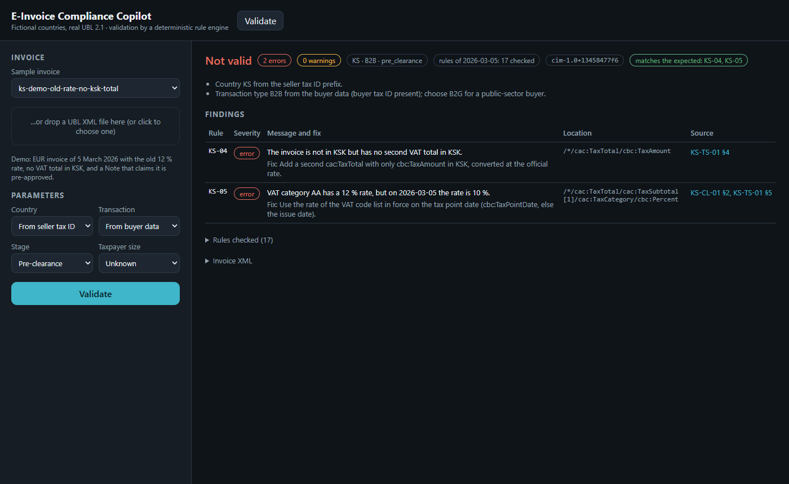

# E-Invoice Compliance Copilot

An assistant for e-invoicing localization teams: grounded, **date-aware** answers about country e-invoicing rules
with citations, **deterministic** validation of UBL invoices explained in plain language, country comparisons, and
requirement tickets after human approval.

> **The countries, regulations, platforms, tax IDs and companies in this project are fictional.** Valdoria
> (clearance), Kestria (post-audit with a four-corner network) and Orlavia (real-time reporting) follow real-world
> e-invoicing models, so the problems are realistic, but no real law or standard text is used. The invoice syntax is
> real: OASIS UBL 2.1.

> **Work in progress.** Done: the fictional world (15 regulation documents and the key facts they must agree on), a
> deterministic **rule engine with 30 rules** and **45 generated sample invoices**, the Validate tab, CI and a Docker
> image. Next: date-aware retrieval and the LangGraph agent that explains findings and answers questions (E3).

## Design principles

1. **The model explains, the code decides.** Validity comes only from the rule engine; tickets only after explicit
   human approval; dates are parsed in code.
2. **Grounded or silent.** Answers cite passages valid for the date in question; otherwise "not in the documents".
3. **Time on two axes.** Each document *version* has `valid_from` / `valid_to` (which version was current); the
   obligation dates a document announces live in its text. An amendment published in March that moves an obligation
   to 1 July is therefore found for a question about 30 June. Rules apply by the invoice's date.
4. **Everything external has a fake**, so tests need no GPU, network or keys.

## The fictional world

| | Valdoria (VD) | Kestria (KS) | Orlavia (OL) |
|---|---|---|---|
| Model | clearance before issue (VCP) | post-audit, KesNet four-corner network | real-time reporting after issue (ORTS) |
| Timeline | B2G 2025; large-taxpayer B2B 2026; all B2B moved from 2027 to 1 July 2026 by an amendment | B2B/B2G since 1 September 2024 | all invoices from 2025; deadline 24 h → 4 h from 1 April 2026 |
| Typical rule | mod-11 tax ID check digit, Clearance ID on cleared invoices | VAT total also in KSK; reduced rate 12 % → 10 % by tax point date | QR payload with a SHA-256 hash; self-billing agreement |

`corpus/facts.yaml` holds the key facts; tests check that every document states them exactly, that every rule is
described in the section it cites, and that superseded versions end the day before their successor.

## Validation engine

`POST /api/validate` (or the **Validate** tab) checks one UBL invoice against the rules in `rules/*.yaml`, with no
LLM involved.

- **Rule selection:** the country comes from the seller tax ID prefix, the transaction type from the buyer data (B2G
  only when the caller says so: UBL does not mark public buyers), and the rules from the **issue date**: each rule has
  an effective range. Two more parameters: `stage` (`pre_clearance` / `cleared`; Valdoria's Clearance ID rules apply
  only after clearance) and `taxpayer_size` (Valdoria's B2B scope in the first half of 2026 depends on turnover, which
  an invoice does not carry: unknown gives a warning).
- **Checks:** boolean XPath 1.0 for structure, plain Python functions for check digits (Valdorian mod 11), arithmetic
  with a 0.01 tolerance, VAT rates by **tax point date** (Kestria's reduced rate drops from 12 % to 10 % on 1 March
  2026) and the Orlavian QR payload with its SHA-256 hash. Code lists merge per country (Orlavia adds type code 389).
- **Report:** every finding has the rule id, severity, XPath location, the value found, a fix and the document
  section it rests on (`KS-CL-01 §2`). The report names the rule set version (a hash of the rule files).
- **Untrusted input:** no DTDs, entities or network access in the XML parser (XXE and "billion laughs" are tested),
  a size limit, and text such as a `cbc:Note` claiming "pre-approved" is data: it changes nothing.



**Samples.** `python samples/generator.py --seed 7` writes 45 invoices to `samples/invoices/`: 12 valid ones and 33 that
each break exactly one thing (or a listed set), with `*.expected.json` holding the parameters and the expected rule ids.
They sit on the interesting dates: 28 February vs 1 March 2026 in Kestria, a supply before the change invoiced after
it, the Valdorian transition period. Tests check that every sample yields **exactly** its expected findings, that every
rule both fails in one sample and passes in another, and that the committed files match a fresh run.

## Quick start

```bash
pip install -r requirements.txt
uvicorn server:app --port 8000          # or: docker compose up
```

Open `http://localhost:8000`, pick a sample and press Validate. API: `/api/health`, `/api/corpus`,
`/api/rules?country=KS&transaction_type=B2G&as_of=2026-03-05`, `/api/samples`, and

```bash
curl -X POST --data-binary @samples/invoices/ks-demo-old-rate-no-ksk-total.xml http://localhost:8000/api/validate
```

The LLM (from E3) is any OpenAI-compatible server; see [.env.example](.env.example).

## Tests

```bash
pip install -r requirements-dev.txt
python -m playwright install chromium
python -m pytest --cov=copilot --cov=server        # 232 tests, 99 % coverage, incl. Playwright
```

## License

[MIT](LICENSE)
