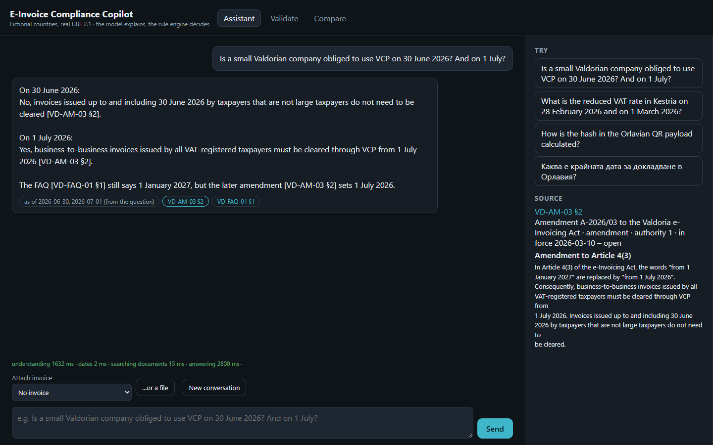
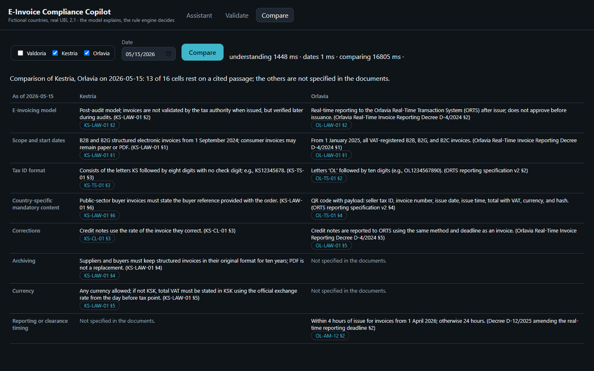

# E-Invoice Compliance Copilot

An assistant for e-invoicing localization teams: grounded, **date-aware** answers about country e-invoicing rules
with citations, **deterministic** validation of UBL invoices explained in plain language, country comparisons, and
requirement tickets after human approval.

> **The countries, regulations, platforms, tax IDs and companies in this project are fictional.** Valdoria
> (clearance), Kestria (post-audit with a four-corner network) and Orlavia (real-time reporting) follow real-world
> e-invoicing models, so the problems are realistic, but no real law or standard text is used. The invoice syntax is
> real: OASIS UBL 2.1.

> **Work in progress.** Done: the fictional world (15 regulation documents and the key facts they must agree on), a
> deterministic **rule engine with 30 rules** and **45 sample invoices**, **date-aware hybrid retrieval** measured on
> 75 questions, and a **LangGraph assistant** that answers with checked citations, explains the engine's findings and
> compares countries. Next: requirement drafts and ServiceNow tickets behind a human-approval interrupt (E4), then
> real-model evals and observability (E5).

## Design principles

1. **The model explains, the code decides.** Validity comes only from the rule engine; tickets only after explicit
   human approval; dates are parsed in code.
2. **Grounded or silent.** Answers cite passages valid for the date in question; otherwise "not in the documents".
3. **Time on two axes.** Each document *version* has `valid_from` / `valid_to` (which version was current); the
   obligation dates a document announces live in its text. An amendment published in March that moves an obligation
   to 1 July is therefore found for a question about 30 June. Rules apply by the invoice's date.
4. **Everything external has a fake**, so tests need no GPU, network or keys.

## The fictional world

| | Valdoria (VD) | Kestria (KS) | Orlavia (OL) |
|---|---|---|---|
| Model | clearance before issue (VCP) | post-audit, KesNet four-corner network | real-time reporting after issue (ORTS) |
| Timeline | B2G 2025; large-taxpayer B2B 2026; all B2B moved from 2027 to 1 July 2026 by an amendment | B2B/B2G since 1 September 2024 | all invoices from 2025; deadline 24 h → 4 h from 1 April 2026 |
| Typical rule | mod-11 tax ID check digit, Clearance ID on cleared invoices | VAT total also in KSK; reduced rate 12 % → 10 % by tax point date | QR payload with a SHA-256 hash; self-billing agreement |

`corpus/facts.yaml` holds the key facts; tests check that every document states them exactly, that every rule is
described in the section it cites, and that superseded versions end the day before their successor.

## Validation engine

`POST /api/validate` (or the **Validate** tab) checks one UBL invoice against the rules in `rules/*.yaml`, with no
LLM involved.

- **Rule selection:** the country comes from the seller tax ID prefix, the transaction type from the buyer data (B2G
  only when the caller says so: UBL does not mark public buyers), and the rules from the **issue date**: each rule has
  an effective range. Two more parameters: `stage` (`pre_clearance` / `cleared`; Valdoria's Clearance ID rules apply
  only after clearance) and `taxpayer_size` (Valdoria's B2B scope in the first half of 2026 depends on turnover, which
  an invoice does not carry: unknown gives a warning).
- **Checks:** boolean XPath 1.0 for structure, plain Python functions for check digits (Valdorian mod 11), arithmetic
  with a 0.01 tolerance, VAT rates by **tax point date** (Kestria's reduced rate drops from 12 % to 10 % on 1 March
  2026) and the Orlavian QR payload with its SHA-256 hash. Code lists merge per country (Orlavia adds type code 389).
- **Report:** every finding has the rule id, severity, XPath location, the value found, a fix and the document
  section it rests on (`KS-CL-01 §2`). The report names the rule set version (a hash of the rule files).
- **Untrusted input:** no DTDs, entities or network access in the XML parser (XXE and "billion laughs" are tested),
  a size limit, and text such as a `cbc:Note` claiming "pre-approved" is data: it changes nothing.


**Samples.** `python samples/generator.py --seed 7` writes 45 invoices to `samples/invoices/`: 12 valid ones and 33 that
each break exactly one thing (or a listed set), with `*.expected.json` holding the parameters and the expected rule ids.
They sit on the interesting dates: 28 February vs 1 March 2026 in Kestria, a supply before the change invoiced after
it, the Valdorian transition period. Tests check that every sample yields **exactly** its expected findings, that every
rule both fails in one sample and passes in another, and that the committed files match a fresh run.

## The assistant (LangGraph)



```
START → route ─┬─► clarify / out_of_scope → END
               └─► extract_date ─┬─► question: retrieve (one search per date) → answer_grounded → END
                                 ├─► validate: validate_invoice → retrieve_rule_docs → explain_findings → END
                                 └─► compare:  compare_countries (one model call per country) → END
```

The model only ever fills a JSON schema (`response_format: json_schema`); code decides what is true:

- **route**: intent, countries, the date *phrases* and a standalone search query. Code rules then correct it: an
  attached invoice plus "check" means validate; naming Valdoria, Kestria or Orlavia is never refused as out of
  scope; validation without an invoice or a comparison of one country becomes a clarifying question. No confidence
  score: it would not be calibrated.
- **extract_date**: `dateparser` (English and Bulgarian) turns the phrases into up to three dates; no date means
  today, and the answer says so. An invoice is judged by its own date.
- **answer_grounded**: answers per date from the passages in force on that date, resolves conflicts by authority and
  publication date, and names them. Every `[DOC §n]` citation must match a retrieved passage: others are removed,
  and an answer that cites nothing valid is replaced by "could not answer". Below the similarity gate the model is
  not asked at all.
- **explain_findings**: the schema only allows the report's rule ids; code checks that each is explained exactly
  once and falls back to the engine's own message for any the model left out. A valid invoice or an unreadable file
  is reported without the model.
- **compare_countries**: for each country, the three best passages per aspect (model, scope, tax ID, mandatory
  content, corrections, archiving, currency, timing), one model call per column; a cell without a valid citation
  becomes "Not specified in the documents."

`POST /api/chat` streams the run as server-sent events (each node's start and duration, the sources, findings or
table, then the answer); the browser reads them with `fetch` because the request is a POST. Threads are kept by
LangGraph's SQLite checkpointer, so a conversation survives a restart; a second message on a busy thread gets 409.
Prompts live in one versioned module ([copilot/graph/prompts.py](copilot/graph/prompts.py)).

With the real model (Gemma 4 26B in LM Studio), checked by hand on the demo questions: the Valdorian question for
30 June and 1 July gets two different answers and names the older FAQ's conflicting date; the Kestrian demo invoice
gets exactly the engine's two findings explained with fixes; Kestria vs Orlavia gives 13 of 16 cells cited.
Two things the first live runs found, both fixed and re-checked: the conflict was never mentioned (0/3 → 3/3 after
making the instruction concrete), and a Bulgarian question about Kestria was refused as out of scope (now a code
rule). Real-model evals with numbers come in E5.



## Date-aware retrieval

`copilot/kb/` turns the corpus into ≤ 600-character chunks (one per `##` section, long sections split with overlap),
embeds them on the CPU with ONNX (`fastembed`, no torch, so the GPU stays free for the chat model) and keeps them in
Chroma. A search takes the date the question is about:

- **Version filter:** only document versions in force on that date (`valid_from <= as_of <= valid_to`), once in the
  Chroma query and again in Python on real dates. Obligation dates a document *announces* never filter it out.
- **Hybrid ranking:** vector search plus BM25, fused with reciprocal rank fusion, because rule ids and codes
  (`VD-09`, `381`, `KSK`) are exact tokens.
- **Abstention gate:** below a calibrated similarity the question counts as not answerable.

`evals/retrieval_benchmark.py` measures it on **75 labelled questions** (63 answerable, 12 not; facts, rules,
versions by date, announced obligations, comparisons, Bulgarian questions), k = 6:

| Embedder | Ranking | hit@1 | hit@3 | MRR | Date-filter violations | Median ms |
|---|---|---|---|---|---|---|
| multilingual MiniLM-L12 | vector | 0.873 | 0.984 | 0.927 | 0 | 2.9 |
| **multilingual MiniLM-L12** | **hybrid (chosen)** | 0.825 | **1.000** | 0.913 | 0 | 3.1 |
| multilingual mpnet-base | vector | 0.825 | 0.968 | 0.889 | 0 | 9.5 |
| multilingual mpnet-base | hybrid | 0.857 | 1.000 | 0.923 | 0 | 9.8 |

Hybrid trades a little hit@1 for no misses in the top 3 (the answer step reads the top passages, not only the
first); mpnet is as good with hybrid ranking but three times slower. **An honest limit:** questions that are on topic
but not covered (a German VAT rate, payroll in Orlavia) score as high as answerable ones, so a similarity threshold
alone can only refuse clearly off-topic questions (4 of 12 at the configured 0.40, while keeping all 63 answerable).
Saying "not in the documents" for the rest is the answer step's job. Full report:
[evals/results/retrieval.md](evals/results/retrieval.md).

```bash
python -m copilot.kb.ingest --rebuild             # build the index ahead of time (the app also syncs it at first use)
python evals/retrieval_benchmark.py               # needs the ONNX models (downloaded once)
```

## Quick start

```bash
pip install -r requirements.txt
uvicorn server:app --port 8000          # or: docker compose up
```

Open `http://localhost:8000`. The Assistant and Compare tabs need an OpenAI-compatible model server (developed with
LM Studio and Gemma 4 26B; see [.env.example](.env.example)); the Validate tab works without one. API: `/api/chat`,
`/api/attachments`, `/api/threads/{id}`, `/api/health`, `/api/corpus`,
`/api/rules?country=KS&transaction_type=B2G&as_of=2026-03-05`, `/api/samples`, and

```bash
curl -X POST --data-binary @samples/invoices/ks-demo-old-rate-no-ksk-total.xml http://localhost:8000/api/validate
```

## Tests

No GPU, model or network needed: a scripted fake LM Studio answers per JSON schema (and refuses scripted answers
that do not match the request's schema), and a hashing embedder stands in for the ONNX model.

```bash
pip install -r requirements-dev.txt
python -m playwright install chromium
python -m pytest --cov=copilot --cov=server        # 289 tests, 99 % coverage, incl. Playwright
```

## License

[MIT](LICENSE)
