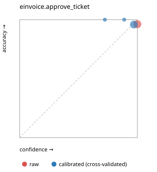

# Calibration: einvoice.approve_ticket

Model `gemma-4-26b-a4b-it`, prompt `9c952d06c491`, 26 labelled cases, fitted temperature **T = 5.8057** (2026-11-24).

| | accuracy | ECE | Brier |
|---|---|---|---|
| raw (T = 1) | 0.962 | 0.038 | 0.077 |
| calibrated, 5-fold cross-validated | 0.962 | 0.026 | 0.086 |

Risk-coverage (calibrated): the share of cases at or above each threshold and their accuracy.

| threshold | coverage | accuracy | n |
|---|---|---|---|
| 0.5 | 1.00 | 0.962 | 26 |
| 0.6 | 1.00 | 0.962 | 26 |
| 0.7 | 1.00 | 0.962 | 26 |
| 0.8 | 0.96 | 0.960 | 25 |
| 0.85 | 0.96 | 0.960 | 25 |
| 0.9 | 0.92 | 0.958 | 24 |
| 0.95 | 0.85 | 0.955 | 22 |
| 0.99 | 0.19 | 0.800 | 5 |

Cases labelled *unclear* (graded by action, not label): 6.

